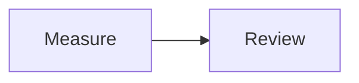

# GitHub Flavored Markdown

Use GitHub Markdown for notes, specifications, checklists, and illustrated
explanations. Choose **GitHub Markdown** in the format menu, or leave **Auto detect**
selected for ordinary prose. Source downloads use `.md` (the extension helper also
recognizes `.markdown`). [Open the starter example](../../index.html?example=gfm-basic&format=gfm).

## Start with prose, a table, and math

````text
# Measurement notes

- [x] Record the measurements
- [ ] Review the result

| Item | Value |
| --- | ---: |
| Length | 3 m |

The area formula is $A = l w$.


````

The preview shows a heading, task list, aligned table, typeset formula, and
flowchart. The table's values and the formula are display content; Markdown does
not calculate an area or execute fenced source code. Select Calca for arrow
calculations or Quarto for Python/R output.

## Syntax reference

| Write | Result |
| --- | --- |
| `# Heading`, `## Subheading` | Document sections |
| `**strong**`, `*emphasis*`, `~~removed~~` | Text emphasis and strikethrough |
| `[label](https://example.com)` | A link; bare web addresses are also linkified |
| `` | An image; a remote image needs its server |
| `- [ ] Task`, `- [x] Done` | A displayed task checklist; edit its state in source |
| `[^detail]` and a later `[^detail]: Explanation` | A footnote |
| `$x^2$`, `$$x^2$$`, or a `math` fence | Inline or display TeX math |
| A `mermaid` fence | A diagram rendered to static SVG |

## Rendering and limits

Sheets uses markdown-it 15.0.3 for tables, strikethrough, autolinks, and Markdown structure, plus plugins for task lists, footnotes, and GitHub alerts (`> [!NOTE]`, TIP, WARNING, IMPORTANT, CAUTION). Fenced code uses highlight.js. This pipeline is shared by the documentation, AsciiMath prose, Calca, and Quarto.

Inline `$…$`, display `$$…$$`, and fenced `math` blocks render TeX through [Temml](https://temml.org/) as native MathML. Currency-like pairs with spaces or numeric suffixes are not treated as math. A fenced `mermaid` block loads Mermaid lazily and renders with strict security settings. Its static SVG passes through the same sanitizer as all other output.

Raw HTML is accepted by the Markdown parser and then sanitized with DOMPurify before entering the page. Scripts, event attributes, forms, embedded documents, arbitrary styles, SVG foreign objects, and animation are removed. A narrow allowlist preserves static SVG and MathML presentation properties. This applies to every format, including dataframe HTML and matplotlib SVG.

## GFM conformance

The committed **github/cmark-gfm 0.29.0.gfm.13** specification has **672 examples**. The actual Sheets Markdown pipeline matches **582/672 (86.6%)** as exact HTML strings. There are **90 documented deviations**. Run `npm run test:conformance` to verify the baseline, or inspect `tests/fixtures/gfm-conformance.json` in the repository for every failed example ID.

An exact-string mismatch can be serialization rather than visual behavior: void tags (`<hr>`, `<br>`, ``) differ from cmark's XHTML spelling, task-list HTML has plugin classes, and code highlighting adds markup. Other differences involve reference resolution, table parsing, nested emphasis, raw HTML filtering, backslash handling, and GitHub's extended autolink behavior. This is a close Markdown implementation with useful extensions, not a claim of exact GitHub parity.

| Spec section with deviations | Count |
| --- | ---: |
| Tabs | 1 |
| Thematic breaks | 11 |
| ATX headings | 1 |
| Setext headings | 11 |
| Indented code blocks | 1 |
| Fenced code blocks | 2 |
| Link reference definitions | 3 |
| Paragraphs | 1 |
| Tables | 1 |
| Block quotes | 4 |
| Task list items | 2 |
| Backslash escapes | 1 |
| Emphasis and strong emphasis | 9 |
| Links | 3 |
| Images | 19 |
| Autolinks | 4 |
| Extended autolinks | 8 |
| Disallowed raw HTML | 1 |
| Hard line breaks | 7 |

The corpus is attributed under CC-BY-SA 4.0 and excluded from deployment. Raw conformance is measured before sanitization and before Mermaid's browser post-pass. Sanitized output intentionally removes unsafe HTML even where the GFM parser preserves it.

Markdown is the fallback format with low Auto confidence. Upstream references: [markdown-it](https://github.com/markdown-it/markdown-it), [GFM spec](https://github.github.com/gfm/), [Mermaid](https://mermaid.js.org/).

An unrendered formula usually means the dollar delimiters are incomplete or the
TeX command is unsupported. Use **Rendered HTML** after diagrams finish to keep
their static SVG in an export. See the [feature comparison and glossary](../format-comparison.md)
for the difference between notation, calculations, diagrams, and plots.

See [Limitations and compatibility](../limitations.md) for the consolidated disclosures across formats.
