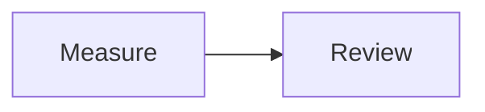
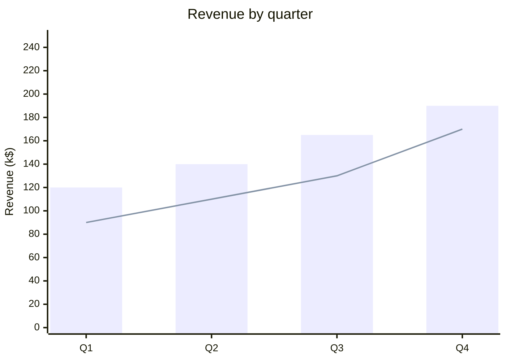
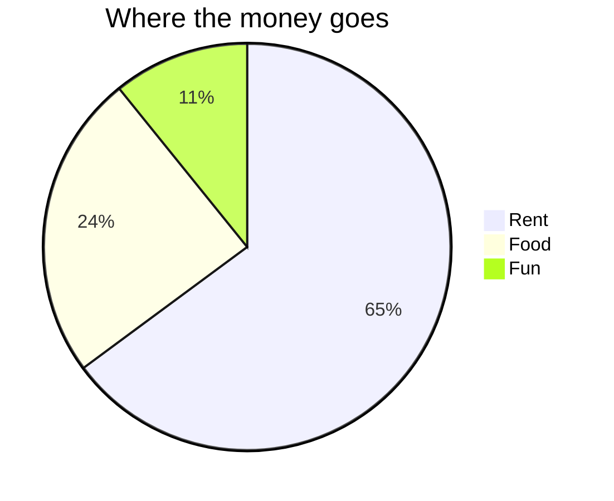
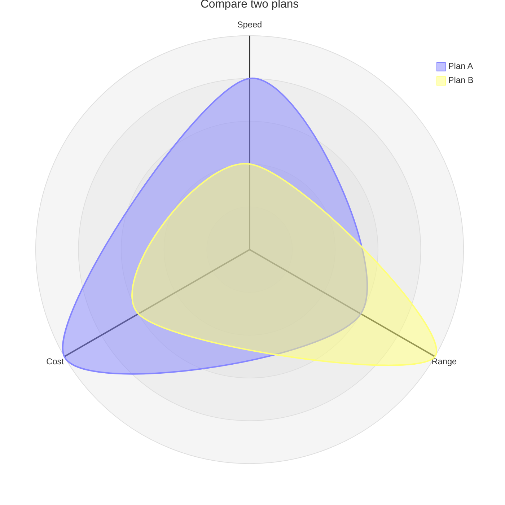

# GitHub Flavored Markdown

Use GitHub Markdown for notes, specifications, checklists, and illustrated
explanations. Choose **GitHub Markdown** in the format menu, or leave **Auto detect**
selected for ordinary prose. Source downloads use `.md` (the extension helper also
recognizes `.markdown`). [Open the starter example](../../index.html?example=gfm-basic&format=gfm).

## Start with prose, a table, and math

````text
# Measurement notes

- [x] Record the measurements
- [ ] Review the result

| Item | Value |
| --- | ---: |
| Length | 3 m |

The area formula is $A = l w$.


````

The preview shows a heading, task list, aligned table, typeset formula, and
flowchart. The table's values and the formula are display content; Markdown does
not calculate an area or execute fenced source code. Select Calca for arrow
calculations or Quarto for Python/R output.

## Syntax reference

| Write | Result |
| --- | --- |
| `# Heading`, `## Subheading` | Document sections |
| `**strong**`, `*emphasis*`, `~~removed~~` | Text emphasis and strikethrough |
| `[label](https://example.com)`, `www.commonmark.org/help` | Explicit links and bare HTTP(S), `www.` addresses, and email links |
| `` | An image; a remote image needs its server |
| `- [ ] Task`, `- [x] Done` | A displayed task checklist; edit its state in source |
| `[^detail]` and a later `[^detail]: Explanation` | A footnote |
| `$x^2$`, `$$x^2$$`, or a `math` fence | Inline or display TeX math |
| A `mermaid` fence | A diagram rendered to static SVG |

## Rendering and limits

Sheets uses markdown-it 15.0.3 for tables, strikethrough, autolinks, and Markdown structure, plus plugins for task lists, footnotes, and GitHub alerts (`> [!NOTE]`, TIP, WARNING, IMPORTANT, CAUTION). Fenced code uses highlight.js. This pipeline is shared by the documentation, AsciiMath prose, Calca, and Quarto.

Inline `$…$`, display `$$…$$`, and fenced `math` blocks render TeX through [Temml](https://temml.org/) as native MathML. Currency-like pairs with spaces or numeric suffixes are not treated as math. A fenced `mermaid` block loads Mermaid lazily and renders with strict security settings. Its static SVG passes through the same sanitizer as all other output.

Raw HTML is accepted by the Markdown parser. GFM raw-text tags (`title`, `textarea`, `style`, `xmp`, `iframe`, `noembed`, `noframes`, `script`, `plaintext`) are escaped as readable text before browser parsing. All output is then sanitized with DOMPurify before entering the page. Active scripts, event attributes, forms, embedded documents, arbitrary styles, SVG foreign objects, and animation are removed. A narrow allowlist preserves static SVG and MathML presentation properties. This applies to every format, including dataframe HTML and matplotlib SVG.

## Charts from Mermaid

Mermaid 12.2.0 also draws charts. Write the numbers into the fence; Markdown
tables are display-only, so a chart never reads values from a table or a
calculation. [Open the chart example](../../index.html?example=gfm-charts&format=gfm).

````text





````

| Chart | Start the fence with | Notes |
| --- | --- | --- |
| Bars and lines | `xychart` (or `xychart-beta`) | `bar` and `line` series share one category axis. Add `horizontal` after the keyword for horizontal bars. Without `y-axis "label" min --> max`, the axis starts at the smallest value rather than zero. |
| Pie | `pie` | One slice per `"label" : value` line. Add `showData` after `pie` to print the values. |
| Radar | `radar-beta` | The `-beta` suffix is required in this Mermaid version; plain `radar` is rejected. |

These charts use Mermaid's neutral theme, not the palette of Org and Beancount
charts. Mermaid draws them with its own layout, so tooltips, legends and
accessible descriptions differ from Sheets' chart renderer. The same fences work
in AsciiMath mixed documents, Quarto, and Calca's Structured blocks and Scoped
definitions modes. Other Mermaid chart types, such as `sankey-beta` and
`treemap-beta`, are not checked by the browser tests. For charts drawn from
calculated values, use Org `#+PLOT:` tables or Quarto plots.


The committed **github/cmark-gfm 0.29.0.gfm.13** specification has **672 examples**. All 90 original deviations have been reviewed and classified. These measurements describe different layers; they should not be combined into a single compatibility percentage.

| Measurement | Exact matches | What it measures |
| --- | ---: | --- |
| Raw parser HTML | 672/672 (100%) | Upstream per-example extension flags and XHTML spelling, without highlighting, task CSS hooks, math, footnotes, alerts, or Mermaid |
| Production HTML | 601/672 (89.4%) | The actual shared Markdown renderer, before sanitization; all GFM extensions and Sheets presentation features enabled |
| Final browser DOM | 627/672 (93.3%) | Actual sanitized output compared with the reference parsed in an inert browser template; HTML5 spelling and attribute ordering follow browser serialization |

The final DOM still preserves text, whitespace, attributes, and element structure: it does not flatten nested markup or remove task classes to inflate the count. Of its 45 differences, 32 are **solely intentional sanitization**: applying the same sanitizer to the reference produces the same DOM. The corpus has no Mermaid post-pass cases; separate browser/export tests cover diagrams and math.

There are **no remaining raw HTML differences in this corpus**. The original URL/email path cases, empty-blockquote newlines, and canonical task serialization now match. The reader also preserves genuinely empty expected output: two former reference-definition mismatches came from an invented newline, not parser behavior. The two task examples marked disabled upstream remain included using their published HTML expectations.

Production retains 71 exact-string differences: 58 HTML5 void-tag spellings, two highlighted fences, two task-list CSS-class differences, and nine extension-mode differences. The last nine are CommonMark examples without autolink/tagfilter flags; production consistently enables those GFM extensions. All remaining corpus differences are presentation, extension mode, or sanitization; none are unexplained.

The shared renderer now preserves left/center/right table alignment in previews and HTML exports, collapses redundant nested bold delimiters, recognizes common `www.` links, and escapes GFM-disallowed raw-text tags. Try these behaviors together:

```text
# Aligned notes

| Left | Center | Right |
| :--- | :---: | ---: |
| one | two | three |

Visit www.commonmark.org/help.

****Bold**** and $x^2$.

- [x] Reviewed

<title>Visible tag text</title>
```

Internal excess parentheses remain inside bare links; unmatched trailing parentheses and entity-like suffixes are excluded. Plus signs work in email local parts, while an invalid plus in the domain prevents the full address from becoming a link:

```text
www.google.com/search?q=(business))+ok
https://example.com/search?q=word&hl;
hello@mail+xyz.example and hello+xyz@mail.example
```

For descriptive labels or addresses outside automatic recognition, use explicit links:

```text
[Full URL](<https://www.google.com/search?q=(business))+ok>)
[Address](mailto:hello+xyz@mail.example)
```

## Autolink limits beyond the corpus

Corpus conformance does not imply complete native-engine parity. The separate audit against **native cmark-gfm 0.29.0.gfm.13** now has **57 fixtures: 53 match and four differences are intentional**. Email-domain underscores and valid prefixes before a plus sign are supported. URL-host underscores may appear before the last two segments, as in the reference.

```text
# Email links

Contact a@b.c_d.
The valid prefix in a@b.c+notes is linked; +notes stays visible.
`a@b.c_d` stays literal in code.
[Contact](mailto:a@b.c_d)
```

The four retained native differences are uppercase WWW recognition, numeric final email-domain characters, Unicode email hosts normalized through IDNA, and preservation of existing HTML anchors. Native cmark can emit a nested email link inside a raw HTML anchor; Sheets keeps that outer link intact. These policies are tracked as **GFM-06** in the central ledger.

```text
WWW.EXAMPLE.COM
a@b.c1
user@παράδειγμα.δοκιμή
<a href="https://example.com">a@b.c_d</a>
```

Code spans, fences, existing Markdown links, HTML anchors, image alt text, and URL paths retain their surrounding contexts. The supplementary email pass only adds links to eligible plain text; existing URL and email matches take precedence. Source text is preserved.

Automatic URL recognition scans at most **10,000 characters after its prefix**. Supplemental GFM email recognition emits only complete candidates of at most **10,000 characters**. Existing library matches keep their behavior, and remaining text stays visible. Use explicit Markdown links for longer addresses within the document size limit.

Run `npm run test:conformance` for raw/production exact HTML and `node scripts/gfm-render-conformance.mjs` for the actual Chromium sanitization measurement. The browser suite checks the same DOM snapshot in Chromium, Firefox, and WebKit. Run `bash scripts/gfm-reference.sh --check` to build the checksum-pinned native oracle and verify all 57 independent fixtures. The reviewed classifications and example IDs are in `tests/fixtures/gfm-audit.json`; the two metric reports are `gfm-conformance.json` and `gfm-render-conformance.json` in that directory. No semantic normalization is applied to either HTML string metric.

The corpus is attributed under CC-BY-SA 4.0 and excluded from deployment. These are reproducible compatibility measurements, not a claim of full GitHub parity.

Markdown is the fallback format with low Auto confidence. Upstream references: [markdown-it](https://github.com/markdown-it/markdown-it), [GFM spec](https://github.github.com/gfm/), [Mermaid](https://mermaid.js.org/).

An unrendered formula usually means the dollar delimiters are incomplete or the
TeX command is unsupported. Use **Rendered HTML** after diagrams finish to keep
their static SVG in an export. See the [feature comparison and glossary](../format-comparison.md)
for the difference between notation, calculations, diagrams, and plots.

See [Limitations and compatibility](../limitations.md) for the consolidated disclosures across formats.

Compare the available libraries and definition syntax in
[built-in and custom functions](../function-comparison.md).

<!-- compatibility:start -->
## Tracked compatibility status

These entries share the [central limitations ledger](../limitations.md). “Needs detailed audit” means the disclosure is recorded, while its complete upstream case coverage is still being developed.

| ID | Status | Area |
| --- | --- | --- |
| GFM-01 | Resolved | All 672 published GFM corpus examples match canonical raw HTML |
| GFM-02 | Intentional | HTML is sanitized after parsing |
| GFM-03 | Needs detailed audit | Math uses Temml's supported TeX notation, not a complete TeX document engine |
| GFM-04 | Intentional | Code fences display code; Markdown formulas and table cells do not calculate |
| GFM-05 | Intentional | Automatic link recognition has bounded candidates |
| GFM-06 | Intentional | Email gaps are fixed; native autolink differences are intentional |
<!-- compatibility:end -->
