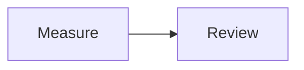

# GitHub Flavored Markdown

Use GitHub Markdown for notes, specifications, checklists, and illustrated
explanations. Choose **GitHub Markdown** in the format menu, or leave **Auto detect**
selected for ordinary prose. Source downloads use `.md` (the extension helper also
recognizes `.markdown`). [Open the starter example](../../index.html?example=gfm-basic&format=gfm).

## Start with prose, a table, and math

````text
# Measurement notes

- [x] Record the measurements
- [ ] Review the result

| Item | Value |
| --- | ---: |
| Length | 3 m |

The area formula is $A = l w$.


````

The preview shows a heading, task list, aligned table, typeset formula, and
flowchart. The table's values and the formula are display content; Markdown does
not calculate an area or execute fenced source code. Select Calca for arrow
calculations or Quarto for Python/R output.

## Syntax reference

| Write | Result |
| --- | --- |
| `# Heading`, `## Subheading` | Document sections |
| `**strong**`, `*emphasis*`, `~~removed~~` | Text emphasis and strikethrough |
| `[label](https://example.com)`, `www.commonmark.org/help` | Explicit links and bare HTTP(S), `www.` addresses, and email links |
| `` | An image; a remote image needs its server |
| `- [ ] Task`, `- [x] Done` | A displayed task checklist; edit its state in source |
| `[^detail]` and a later `[^detail]: Explanation` | A footnote |
| `$x^2$`, `$$x^2$$`, or a `math` fence | Inline or display TeX math |
| A `mermaid` fence | A diagram rendered to static SVG |

## Rendering and limits

Sheets uses markdown-it 15.0.3 for tables, strikethrough, autolinks, and Markdown structure, plus plugins for task lists, footnotes, and GitHub alerts (`> [!NOTE]`, TIP, WARNING, IMPORTANT, CAUTION). Fenced code uses highlight.js. This pipeline is shared by the documentation, AsciiMath prose, Calca, and Quarto.

Inline `$…$`, display `$$…$$`, and fenced `math` blocks render TeX through [Temml](https://temml.org/) as native MathML. Currency-like pairs with spaces or numeric suffixes are not treated as math. A fenced `mermaid` block loads Mermaid lazily and renders with strict security settings. Its static SVG passes through the same sanitizer as all other output.

Raw HTML is accepted by the Markdown parser. GFM raw-text tags (`title`, `textarea`, `style`, `xmp`, `iframe`, `noembed`, `noframes`, `script`, `plaintext`) are escaped as readable text before browser parsing. All output is then sanitized with DOMPurify before entering the page. Active scripts, event attributes, forms, embedded documents, arbitrary styles, SVG foreign objects, and animation are removed. A narrow allowlist preserves static SVG and MathML presentation properties. This applies to every format, including dataframe HTML and matplotlib SVG.

## GFM conformance

The committed **github/cmark-gfm 0.29.0.gfm.13** specification has **672 examples**. All 90 original deviations have been reviewed and classified. These measurements describe different layers; they should not be combined into a single compatibility percentage.

| Measurement | Exact matches | What it measures |
| --- | ---: | --- |
| Raw parser HTML | 662/672 (98.5%) | Upstream per-example extension flags and XHTML spelling, without highlighting, math, footnotes, alerts, or Mermaid |
| Production HTML | 593/672 (88.2%) | The actual shared Markdown renderer, before sanitization; all GFM extensions and Sheets presentation features enabled |
| Final browser DOM | 619/672 (92.1%) | Actual sanitized output compared with the reference parsed in an inert browser template; HTML5 spelling and attribute ordering follow browser serialization |

The final DOM still preserves text, whitespace, attributes, and element structure: it does not flatten nested markup or remove task classes to inflate the count. Of its 53 differences, 32 are **solely intentional sanitization**: applying the same sanitizer to the reference produces the same DOM. The corpus has no Mermaid post-pass cases; separate browser/export tests cover diagrams and math.

The **10 remaining raw-parser differences** are:

| Classification | Example IDs | Behavior |
| --- | --- | --- |
| Semantic gap | 625, 626, 630 | Internal excess closing parentheses in URLs, entity-like URL suffixes, and plus signs in email domains differ from GFM |
| Serialization | 176, 187, 188, 217, 218 | Empty documents/blockquotes emit different newlines; link reference resolution matches |
| Serialization | 279, 280 | Task state and disabled checkboxes match, but the plugin adds CSS classes; both examples are marked disabled upstream and still measured here |

Production has 79 exact-string differences: the three semantic gaps, five newline differences, two task-class differences, 58 HTML5 void-tag spellings, two highlighted fences, and nine extension-mode differences. The last nine are CommonMark examples without autolink/tagfilter flags; production consistently enables those GFM extensions. This is documented behavior, not an unexplained parser regression.

The shared renderer now preserves left/center/right table alignment in previews and HTML exports, collapses redundant nested bold delimiters, recognizes common `www.` links, and escapes GFM-disallowed raw-text tags. Try these behaviors together:

```text
# Aligned notes

| Left | Center | Right |
| :--- | :---: | ---: |
| one | two | three |

Visit www.commonmark.org/help.

****Bold**** and $x^2$.

- [x] Reviewed

<title>Visible tag text</title>
```

For URL punctuation that hits the three remaining gaps, use explicit links:

```text
[Full URL](<https://www.google.com/search?q=(business))+ok>)
[Address](mailto:hello+xyz@mail.example)
```

Run `npm run test:conformance` for raw/production exact HTML and `node scripts/gfm-render-conformance.mjs` for the actual Chromium sanitization measurement. The browser suite checks the same DOM snapshot in Chromium, Firefox, and WebKit. The reviewed classifications and example IDs are in `tests/fixtures/gfm-audit.json`; the two metric reports are `gfm-conformance.json` and `gfm-render-conformance.json` in that directory. No semantic normalization is applied to either HTML string metric.

The corpus is attributed under CC-BY-SA 4.0 and excluded from deployment. These are reproducible compatibility measurements, not a claim of full GitHub parity.

Markdown is the fallback format with low Auto confidence. Upstream references: [markdown-it](https://github.com/markdown-it/markdown-it), [GFM spec](https://github.github.com/gfm/), [Mermaid](https://mermaid.js.org/).

An unrendered formula usually means the dollar delimiters are incomplete or the
TeX command is unsupported. Use **Rendered HTML** after diagrams finish to keep
their static SVG in an export. See the [feature comparison and glossary](../format-comparison.md)
for the difference between notation, calculations, diagrams, and plots.

See [Limitations and compatibility](../limitations.md) for the consolidated disclosures across formats.

<!-- compatibility:start -->
## Tracked compatibility status

These entries share the [central limitations ledger](../limitations.md). “Needs detailed audit” means the disclosure is recorded, while its complete upstream case coverage is still being developed.

| ID | Status | Area |
| --- | --- | --- |
| GFM-01 | Known gap | GFM has three remaining autolink boundary gaps; all corpus differences are classified |
| GFM-02 | Intentional | HTML is sanitized after parsing |
| GFM-03 | Needs detailed audit | Math uses Temml's supported TeX notation, not a complete TeX document engine |
| GFM-04 | Needs detailed audit | Code fences display code; Markdown formulas and table cells do not calculate |
<!-- compatibility:end -->
