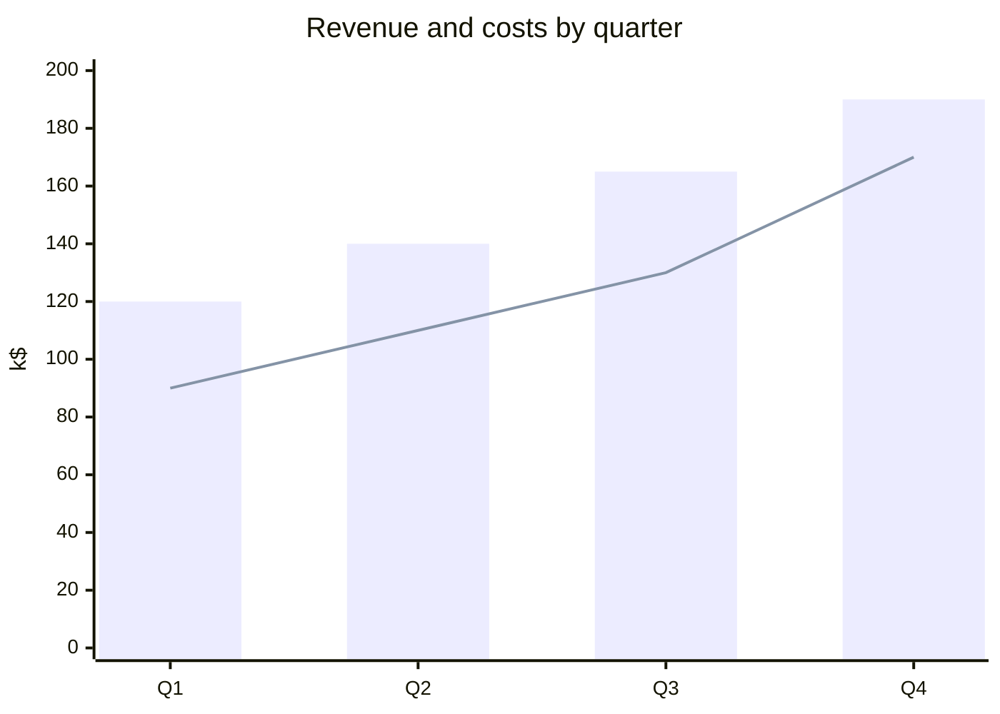
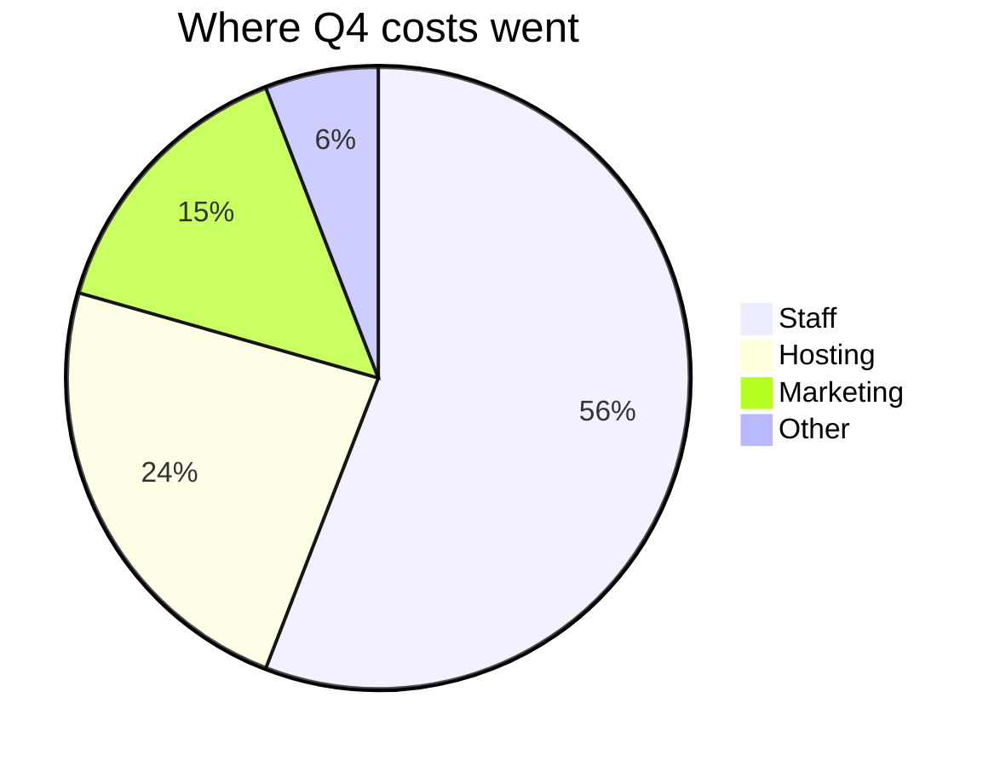
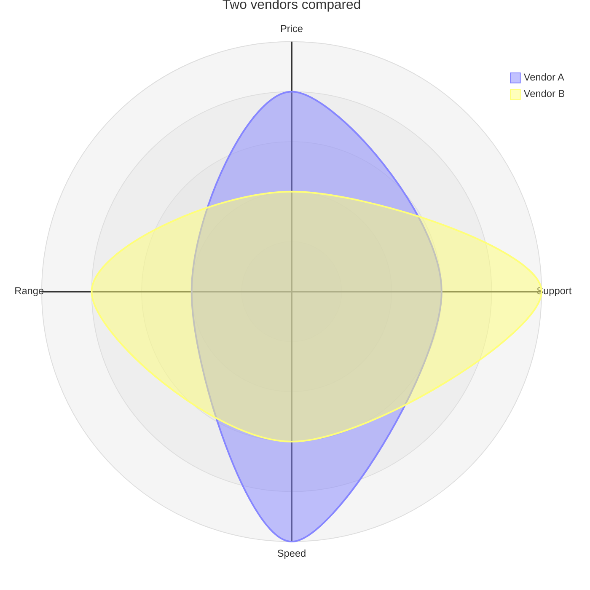

# Quarterly review

Mermaid draws these charts from the numbers written in each fence. They do not
read the table, so update both when the figures change.

| Quarter | Revenue (k$) | Costs (k$) |
| --- | ---: | ---: |
| Q1 | 120 | 90 |
| Q2 | 140 | 110 |
| Q3 | 165 | 130 |
| Q4 | 190 | 170 |

